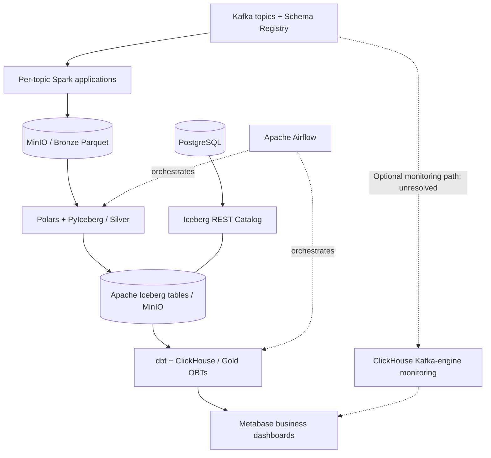
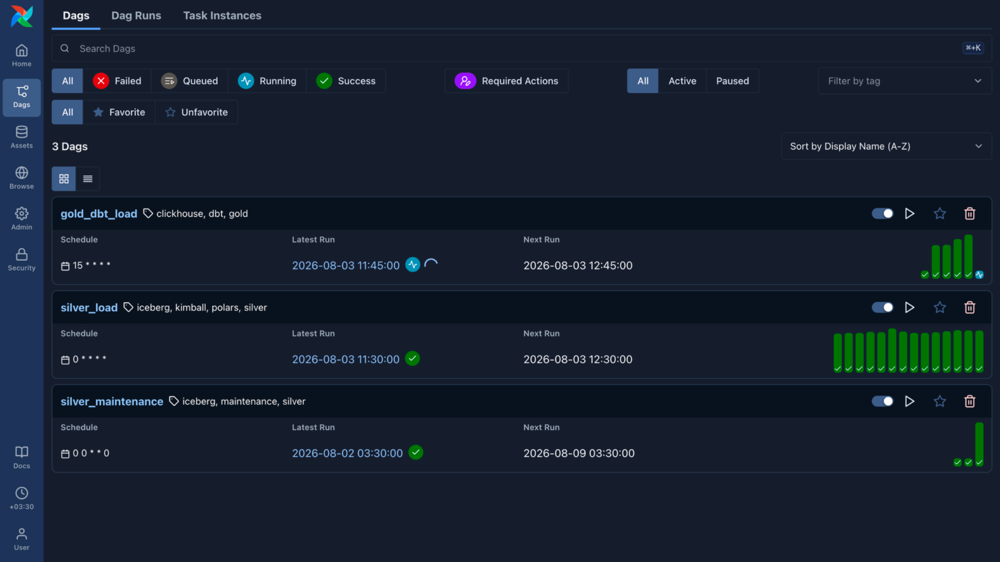
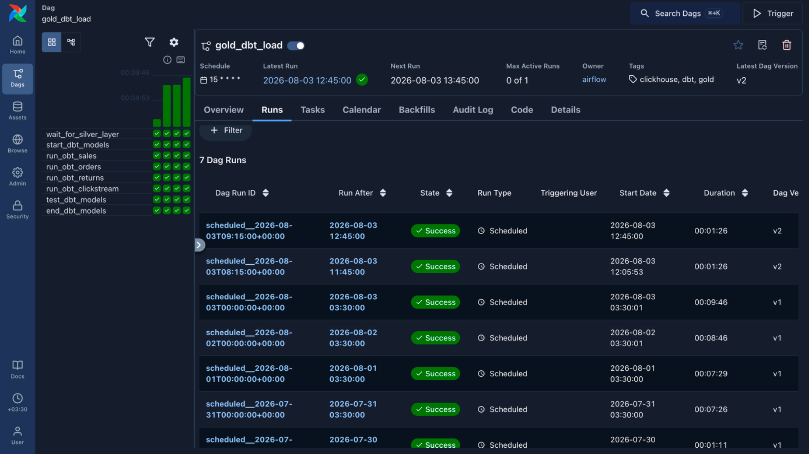

# E-commerce Data Lakehouse

**An end-to-end data engineering pipeline | Team bootcamp capstone**

This collaborative, evaluated Data Engineering bootcamp project demonstrates
Kafka ingestion, object storage, dimensional modeling, analytics, and workflow
orchestration using a local Bronze–Silver–Gold lakehouse. It is an educational
Docker Compose deployment, not a hosted or production e-commerce service.

## Architecture



The Bronze launcher starts one independent Spark application per configured
Kafka topic, rather than running all topics in one Spark context. The optional
direct Kafka-to-ClickHouse monitoring path was implemented but encountered a
broker compatibility issue and is **not presented as verified operational**.
See the [Metabase documentation](metabase/README.md) for details.

## Technology stack

| Layer | Technologies | Purpose |
|---|---|---|
| Ingestion | Kafka, Confluent Schema Registry, Spark Structured Streaming | Decode Avro and write partitioned Parquet |
| Bronze storage | MinIO, Parquet | Persist raw/standardized event data and checkpoints |
| Silver | Polars, PyIceberg, Apache Iceberg, REST Catalog, PostgreSQL | Dimensional modeling, quality checks, auditable publication |
| Gold | dbt, ClickHouse | Analytics-ready one-big-table models |
| Presentation | Metabase | Team-built SQL-based business dashboards |
| Orchestration | Apache Airflow | Silver and Gold workflows |
| Deployment | Docker Compose | Local multi-service stack |

## Data model and workflows

The Silver layer defines **nine dimensions** and **four facts**:
`fact_sales`, `fact_orders`, `fact_clickstream`, and `fact_returns`.
The Gold layer contains four corresponding OBT models:
`obt_sales`, `obt_orders`, `obt_clickstream`, and `obt_returns`.

Silver uses dimensional modeling, point-in-time joins for SCD Type 2
attributes, data-quality checks, and a Write-Audit-Publish workflow.
Not all fact models use the same load strategy: `fact_returns` is documented
as a full rebuild, while the other three use incremental loading with look-back.

The Bronze layer uses a separate `spark-submit` application and checkpoint for
each Kafka topic. Its writes are documented as **at-least-once**, with
deduplication handled downstream.

## Evidence of execution

Screenshots from the team's Airflow environment document successful DAG runs.
They are historical execution evidence, not a claim that the full stack is
currently running or that every dataset was populated.





The core Metabase dashboards were subsequently deployed by other team members.
No deployment screenshots for that part are included in this repository summary.

## Local setup

Prerequisites: Docker and Docker Compose. The stack also depends on access to
the configured Kafka broker and Schema Registry.

```bash
cp .env.example .env
# Set the required credentials and service endpoints in .env.
docker compose up -d --build
docker compose ps
```

Do not commit `.env`, access keys, or service credentials. Refer to the
component READMEs for configuration, individual service commands, and known
operational limitations.

## Project context and individual contributions

This was a **team project**, not a solo build. My contributions included:

- **Bronze:** Kafka-to-MinIO ingestion and Avro/Parquet pipeline work.
- **Silver:** Dimensional modeling and transformation work.
- **Gold:** dbt/ClickHouse analytics models.
- **Orchestration:** Work on the Gold Airflow DAG.

These describe contributions within a shared codebase, not sole authorship of
all components. The Metabase presentation layer and other infrastructure also
include work completed by teammates.

## Scope and limitations

- This is a local educational stack, not a production deployment with high
  availability, hardened networking, or managed security.
- Data quality and completeness depend on the upstream generator. The presence
  of returns models and successful DAG runs does not by itself prove that a
  specific returns dataset was nonempty.
- The core Metabase dashboards were deployed by teammates after an earlier
  static-validation stage. Their deployment is reported by the team, rather
  than evidenced by screenshots here.
- The optional direct Kafka-to-ClickHouse monitoring path had an unresolved
  broker compatibility issue in the available technical notes; do not treat it
  as a verified live feature.

## Component documentation

- [Spark cluster and S3A configuration](spark/README.md)
- [Bronze ingestion](jobs/bronze_ingestion/README.md)
- [Silver modeling and quality gates](jobs/silver/README.md)
- [Metabase dashboards and monitoring status](metabase/README.md)
