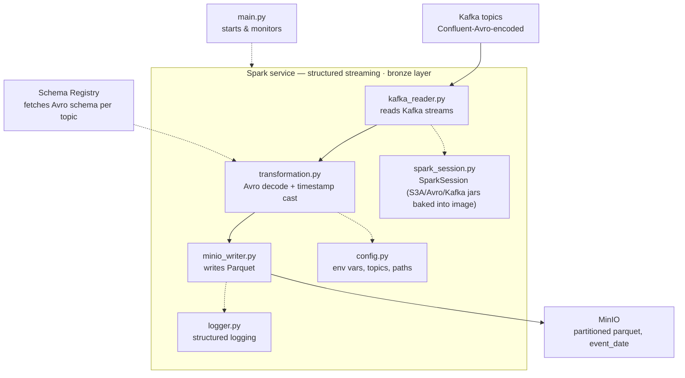

# Bronze ingestion job

Spark Structured Streaming job that reads the project's Kafka topics,
decodes each topic's Avro payload via the Confluent Schema Registry,
standardizes timestamps, and writes the result to the MinIO `bronze` bucket
as Parquet partitioned by `event_date` (`s3a://bronze/<topic>/event_date=…`).

**One Spark job per topic.** `main.py` runs as a launcher that `spark-submit`s
one independent application per topic (N topics → N apps), so topics are
isolated — a schema change or failure on one only affects that topic's job, and
restarting it is just re-submitting that one. Each job runs a single streaming
query for its topic.

Records that can't be decoded (unknown schema ID, or corrupt Avro bytes) are
not dropped or allowed to crash the batch — Avro decoding runs in `PERMISSIVE`
mode and those rows are routed, raw bytes intact, to a **dead-letter queue**
at `s3a://bronze/_dlq/<topic>/` for later inspection or replay. Because both
sinks are fed from a single Kafka read (via `foreachBatch`), the Parquet
writes are **at-least-once**, not exactly-once — dedupe downstream in silver.

Bucket layout (all under the dedicated `bronze` bucket):

```
s3a://bronze/
  <topic>/event_date=…/         # decoded rows
  _dlq/<topic>/                 # undecodable rows (raw key/value/schema_id/reason)
  _checkpoints/<topic>/         # per-topic streaming checkpoint
```

## Architecture



`spark_session.py`, `config.py`, and `logger.py` are the shared foundation —
every pipeline module imports from all three; the diagram only shows one
edge apiece to keep it readable.

## Why Avro, not JSON

The cluster serializes every topic's Kafka value with Confluent's
Schema-Registry wire format (a magic byte + 4-byte schema ID + Avro binary),
not plain JSON text. Avro binary isn't self-describing — it can only be
parsed with the exact *writer* schema each record was serialized with — so
`transformation.py`'s `SchemaTransformer` reads the schema ID embedded in
each record and decodes it against *that* schema. Decoding everything against
one "latest" schema instead would silently corrupt any record written under
an older/different version.

Spark's JVM `from_avro` takes a single static schema per column and can't
vary it per row, so `process()` fetches every registered `(schema id,
schema)` pair for the topic at job start and builds a `CASE WHEN schema_id =
… THEN from_avro(payload, that_schema)` chain — one branch per version, each
decoding with the correct writer schema. The branches' decoded structs have
different types, so they're unified by serializing each to JSON (`to_json`)
and re-parsed once with `from_json` against a fixed reader schema (the
topic's latest schema as a Spark `StructType`). This keeps the whole decode
on the JVM — no Python UDF, nothing extra to ship to the executors. Its one
limit: a schema version registered *after* job start isn't in the chain, so
its records fall through to null until the job is restarted (which re-reads
the version list) — never mis-parsed, just deferred.

Avro's logical types already do most of bronze's "basic transformation" work
for free — `decimal` fields decode straight to Spark `DecimalType`, `date`/
`timestamp-*` fields decode straight to `Date`/`TimestampType`, and the
JSON round-trip preserves them (timestamps at microsecond precision via an
explicit format) — so the only manual timestamp casting needed is for fields
Avro declares as plain strings (currently just `behavioral.events.timestamp`).

## Layout

- `config.py` — loads settings from the environment (see `.env.example`) into `BronzeConfig`; fails fast if a required variable is missing. Also holds the per-topic decode maps (`TOPIC_EVENT_DATE_COLUMN`, `TOPIC_STRING_TIMESTAMP_COLUMNS`) and the bronze/dlq/checkpoint bucket paths.
- `logger.py` — shared stdlib logger setup (`get_logger`).
- `spark_session.py` — builds the `SparkSession`. S3A, Kafka, and Avro support all come from jars baked into the custom image at build time (see `spark/Dockerfile`), not resolved here.
- `kafka_reader.py` — subscribes to a single topic as a streaming `DataFrame`, preserving raw `key`/`value`/`topic` and renaming Kafka's own record timestamp to `kafka_ingest_timestamp` (so it doesn't collide with a same-named business field in some payloads).
- `schema_registry.py` — minimal HTTP client: fetches a subject's latest Avro schema JSON, or every registered version paired with its schema ID (`fetch_all_schemas`).
- `transformation.py` — `SchemaTransformer`: `process()` decodes a topic's Avro payload per-record against its embedded schema ID (a `PERMISSIVE` `from_avro` `CASE WHEN` chain over the registered schema IDs, unified via `to_json`/`from_json`) and keeps the raw `value` + a nullable `data` struct; `good_rows()` explodes the successfully-decoded rows (casting plain-string timestamps, deriving `event_date`) and `dead_letters()` selects the undecodable ones (raw bytes + `schema_id` + `dlq_reason`) for the DLQ.
- `minio_writer.py` — `MinIOWriter`: one `foreachBatch` streaming query per topic that writes good rows to `s3a://<bucket>/<topic>` (partitioned by `event_date`) and decode failures to `s3a://<bucket>/_dlq/<topic>`, checkpointed under `_checkpoints/<topic>`. Single Kafka read → both sinks, so writes are at-least-once.
- `launcher.py` — `submit_all()`: spark-submits one job per topic in `KAFKA_TOPICS`, then supervises the child processes, **respawning each independently** when it dies (with a backoff) rather than tearing down the others — one topic crash-looping never touches the rest. Deliberately has no pyspark import (runs under plain `python3`, which — unlike `spark-submit` — can't resolve it).
- `main.py` — `run(topic)`: the single-topic job (read → decode → good/DLQ split → write, then `query.awaitTermination()`). Only ever runs under `spark-submit`, which is what gives it pyspark.
- `run_bronze_ingestion.py` (in `jobs/`, one level up) — entry point that dispatches on `--topic`, importing lazily per branch so the launcher path never touches pyspark: absent → `launcher.submit_all()` (run with plain `python`); present → `main.run(topic)` (what the launcher hands to `spark-submit`). Sits outside the package so `spark-submit` can run it directly (it can't run the package's relative-import modules as a script); Python puts the script's dir on `sys.path`, so `import bronze_ingestion` resolves.

## Configuration

`cp .env.example .env` and adjust as needed. See `.env.example` for the full
list of variables `BronzeConfig.from_env()` reads: Kafka connection
details, the Schema Registry URL, the MinIO bronze/checkpoint paths, and
Spark tuning.

## Running

The normal path is `docker compose up -d --build` from the repo root — the
`bronze-ingestion` service builds this job into the Spark image and runs the
launcher (`python … run_bronze_ingestion.py`), which `spark-submit`s one job
per topic in `KAFKA_TOPICS` (see the root `README.md` for the required `.env`
variables: `KAFKA_BOOTSTRAP_SERVERS`, `KAFKA_TOPICS`, `SCHEMA_REGISTRY_URL`).
Because every job's client-mode driver runs inside that container, size its
memory for the topic count (`--driver-memory` is capped at 512m per job).

To run a single topic manually (e.g. to restart just one):

```
docker compose exec bronze-ingestion \
    /opt/spark/bin/spark-submit --master spark://spark-master:7077 \
    /opt/spark-apps/jobs/run_bronze_ingestion.py --topic transactional.orders
```

No `--packages` flag needed — the Kafka/Avro/S3A jars are already baked
into the image (see `spark/Dockerfile`), which also means starting the job
doesn't need internet access to Maven Central or a writable Ivy cache.

The single-schema-per-topic decode path was verified against the project's
real Kafka cluster and Schema Registry: all topics with a registered schema
decoded and landed in MinIO correctly, partitioned by `event_date`. The
per-schema-ID decode (the `from_avro` `CASE WHEN` chain over registered
versions, unified via `to_json`/`from_json`) has **not** yet been re-verified
end-to-end against the cluster — do that before relying on it in production,
paying particular attention to the JSON round-trip of `decimal` and
microsecond `timestamp` fields.

## One job per topic

Each topic is its own `spark-submit` application (its own driver), launched by
`launcher.py`'s `submit_all()`. This isolates topics — one can be restarted,
resized, or fail without touching the others, and a schema change only
restarts the affected job. There's no shared SparkContext and so no need for
the FAIR scheduler / per-topic pools an all-in-one-app design would have
required to avoid starvation.

**Core allocation is explicit, not left to defaults.** Standalone Spark grants
an application *every available core* unless capped — with N independent
applications on one worker, that means whichever app starts first takes all
the cores and the rest sit at 0 cores in `WAITING` state forever (observed
directly in the Spark UI). `launcher.py` divides `SPARK_WORKER_CORES` evenly
across the topic count and passes `--total-executor-cores` on each
`spark-submit`, so every topic is guaranteed a fair, nonzero share and can
actually run concurrently with the others.

Sizing caveats: the N per-topic jobs still share the Spark worker's fixed core
count (`SPARK_WORKER_CORES` — see the root `.env.example`; more topics than
cores means less than 1 core each gets floored up to 1, oversubscribing the
worker), and because Spark on standalone only supports **client mode** for
PySpark, all N driver JVMs run inside the `bronze-ingestion` container — size
its memory for the topic count (`--driver-memory` is capped at 512m per job).

## Known data-quality note

Every `transactional.orders` record currently has its business `timestamp`
field hardcoded to the epoch (`1970-01-01T00:00:00Z`) — confirmed present
in the raw Avro payload itself, not introduced by this code. That's an
upstream data-generator issue, not something bronze should paper over
(anomaly detection is explicitly a silver-layer/monitoring concern per the
project spec) — `kafka_ingest_timestamp` is preserved on every row
specifically so this stays visible instead of being silently masked.
