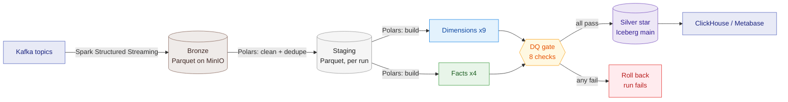
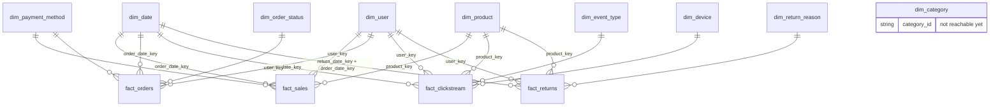
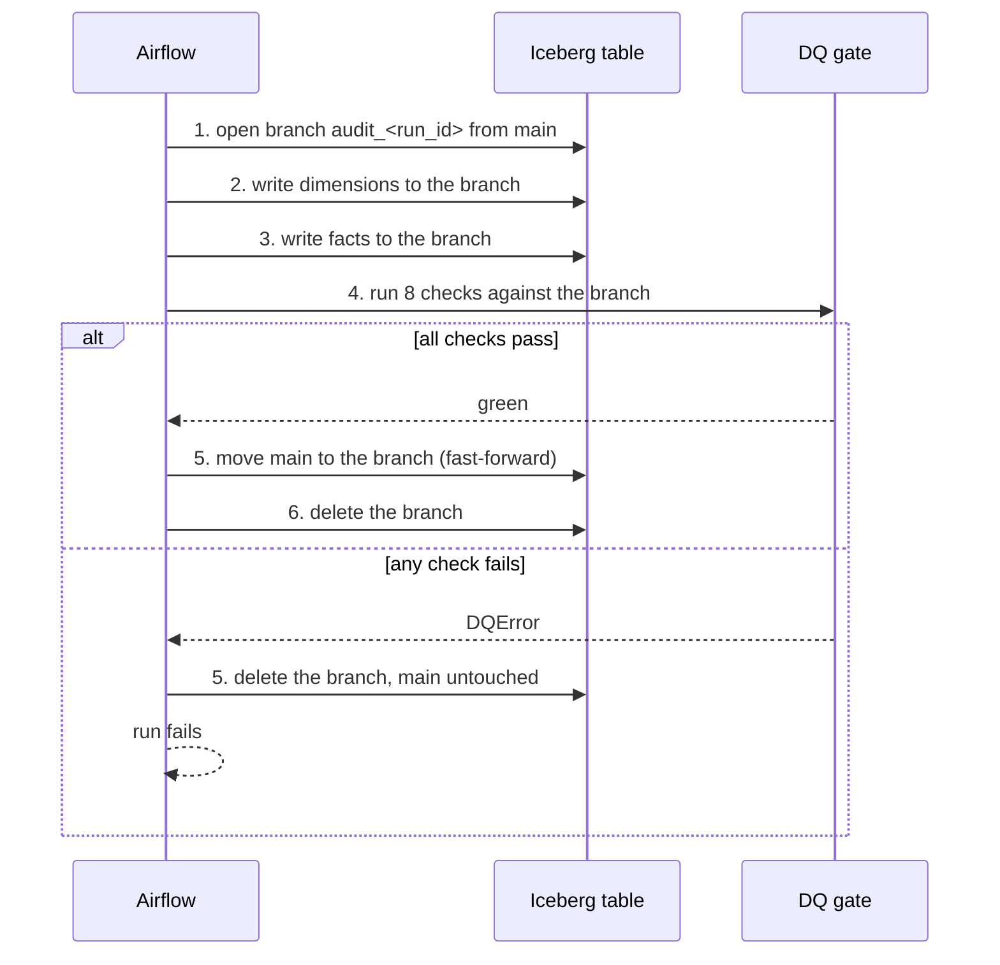
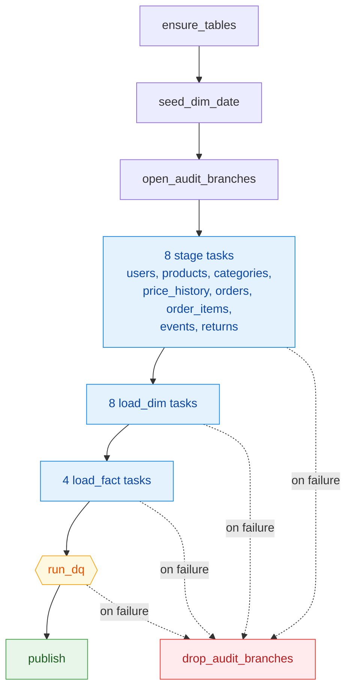
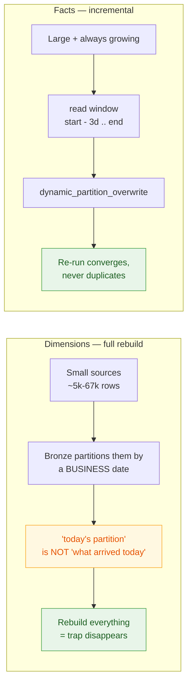
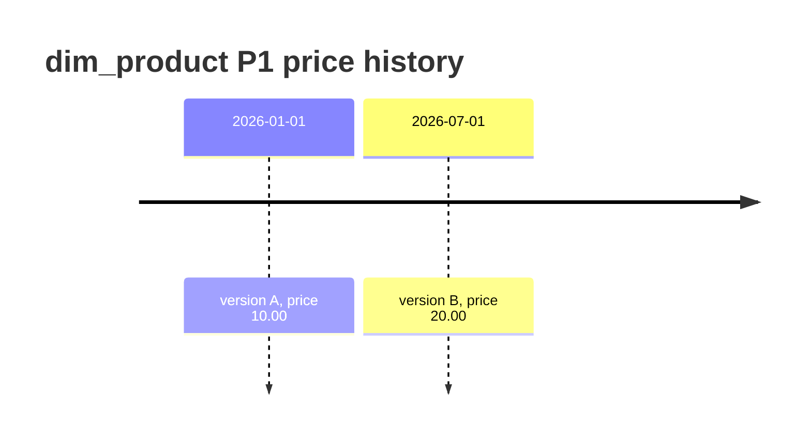
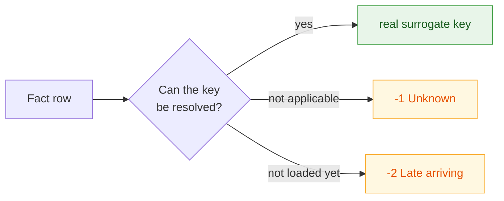

# Silver layer — Kimball star on Iceberg

Turns raw Bronze Parquet into a clean **Kimball star schema**: 9 dimensions and
4 facts, stored as Apache Iceberg tables and queried by ClickHouse / Metabase.

**Engine: Polars + PyIceberg — no Spark, no JVM.** Each Airflow task runs in an
isolated venv at `/opt/venvs/silver`.

---

## 1. The big picture



---

## 2. The star schema

Facts are green, dimensions blue. `dim_date`, `dim_user` and `dim_product` are
**conformed** — the same key means the same thing in every fact, which is what
makes cross-fact analysis (returns vs sales) possible.



| Fact | One row per | Load style | Partitioned by |
|---|---|---|---|
| `fact_sales` | order **line item** | incremental + look-back | `order_date_key` |
| `fact_orders` | **order** (header) | incremental + look-back | `order_date_key` |
| `fact_clickstream` | behavioural **event** | incremental + look-back | `event_date_key` |
| `fact_returns` | **return** | full rebuild | `return_date_key` |

> ⚠️ **Never join `fact_orders` to `fact_sales` and sum.** They overlap —
> `fact_orders` is a rollup of `fact_sales`. Use one or the other.

**Dimensions:** `dim_date`, `dim_user` (SCD2), `dim_product` (SCD2),
`dim_category`, `dim_payment_method`, `dim_order_status`, `dim_event_type`,
`dim_device`, `dim_return_reason`.

---

## 3. How one run works (Write-Audit-Publish)

Nothing is written to `main` until every quality check passes. Readers never
see a half-loaded star.



---

## 4. Task graph



`drop_audit_branches` uses `trigger_rule="one_failed"`. It cleans up **and then
raises**, so a broken run is reported as failed. Without that it was the only
leaf task, and Airflow marked runs green while tasks underneath had failed.

---

## 5. Why dimensions rebuild but facts are incremental



A user with `signup_date = 2024-03-01` arriving in Kafka today lands in the
`event_date=2024-03-01` partition. An incremental dimension read would miss
them **forever**. Rebuilding the small dimensions each run avoids this.

Surrogate keys are a **hash** of (natural key + `valid_from`), not a row number.
A rebuild therefore produces the same keys, so fact foreign keys never break.

---

## 6. Point-in-time joins (SCD2)

The most important rule in the layer: a fact row is joined to the dimension
version that was valid **at the moment of the transaction**, not the current one.



An order placed 2026-02-01 must join **version A**. Joining on
`is_current = true` would price it at 20.00 and quietly corrupt every historical
report. Polars `join_asof(strategy="backward")` does this in one call.

---

## 7. Quality checks (the gate)

| Check | What it protects |
|---|---|
| `unique_grain` | no duplicate rows — proves dedupe works |
| `no_null_fks` | no NULL foreign keys anywhere |
| `measure_sanity` | net ≤ gross, discount ≥ 0, quantity > 0 |
| `reconciliation` | `order.total == sum(qty × unit_price)` |
| `order_completeness` | how many orders arrived with no line items |
| `scd2_invariants` | exactly one current row per key, no overlaps |
| `returns_reference_sales` | returns point at orders we actually have |
| `returns_resolve_products` | returns can be traced to the product sold |

Three of these measure **upstream problems** silver cannot fix (missing order
lines, returns naming unknown items). Their thresholds are set above the
measured value on purpose: they exist to catch a feed *breaking*, not to block
on a known defect. Every run reports the numbers so the trend stays visible.

---

## 8. Missing values are never NULL and never dropped



Rows that fail a cleaning rule go to a **quarantine** file with a
`reject_reason` — they are never silently deleted, so counts always reconcile.

---

## 9. Files

| File | Class | Does |
|---|---|---|
| `config.py` | `SilverConfig` | every setting, validated at startup |
| `ddl.py` | `DDLParser`, `ModelRegistry` | reads `model/*.sql` into Iceberg schemas |
| `catalog.py` | `IcebergCatalog` | create tables, cast frames, 3 write modes |
| `io.py` | `BronzeReader`, `StagingStore`, `IcebergReader` | all reading and writing |
| `wap.py` | `WapManager` | branch, publish, roll back |
| `maintenance.py` | `Maintenance` | expire snapshots, sweep old branches |
| `transforms/staging.py` | `StagingTransforms` | clean + dedupe each source |
| `transforms/dims.py` | `DimensionBuilder` | build the 9 dimensions |
| `transforms/facts.py` | `FactBuilder` | build the 4 facts |
| `transforms/dq.py` | `DataQualityGate` | the 8 checks |
| `runner.py` | functions | the work behind each task |
| `tasks.py` | functions | what Airflow calls |
| `model/*.sql` | — | **the only place a column is defined** |

> `tasks.py` must stay plain functions. `ExternalPythonOperator` copies only the
> function's own source into the venv, so a method (with `self`) or a call to
> anything at module level fails at runtime with `NameError`.

---

## 10. Deploy

Silver needs no separate deployment — it ships inside the Airflow image.

```bash
docker compose up -d                 # start everything
docker compose build airflow-scheduler && \
  docker compose up -d --no-deps \
    airflow-scheduler airflow-apiserver \
    airflow-dag-processor airflow-triggerer   # after changing requirements.txt
```

Rebuild is only needed when `jobs/silver/requirements.txt` changes — the venv is
baked into the image. `dags/` and `jobs/` are **bind-mounted**, so ordinary code
changes are picked up on the next run with no rebuild at all.

`silver_load` runs `@hourly` and `silver_maintenance` `@weekly`; both start on
their own once the stack is up.

## 11. Run and inspect

```bash
# trigger a run by hand -- ALWAYS pass a logical date
docker compose exec airflow-scheduler airflow dags trigger silver_load \
  -r my_run -l 2026-07-29T12:00:00+00:00

# recent runs, and the task states of one run
docker compose exec airflow-scheduler airflow dags list-runs silver_load
docker compose exec airflow-scheduler airflow tasks states-for-dag-run silver_load my_run

# check settings and DDL parse without touching the cluster
docker compose exec -e PYTHONPATH=/opt/airflow airflow-scheduler \
  /opt/venvs/silver/bin/python -c "\
from jobs.silver.config import load_config; from jobs.silver.ddl import REGISTRY; \
c=load_config(); print('namespace', c.namespace, '| lookback', c.lookback_days); \
print(len(REGISTRY), 'tables:', REGISTRY.names())"

# row counts for every table
docker compose exec -e PYTHONPATH=/opt/airflow airflow-scheduler \
  /opt/venvs/silver/bin/python -c "\
from jobs.silver.catalog import IcebergCatalog; c=IcebergCatalog(); \
[print('%-22s %8d' % (n, c.load(n).scan().to_arrow().num_rows)) for n in c.registry]"

# run the quality checks against published main
docker compose exec -e PYTHONPATH=/opt/airflow airflow-scheduler \
  /opt/venvs/silver/bin/python -c "\
from jobs.silver.transforms.dq import DataQualityGate as G; g=G(); \
[print('%-28s %s' % (n, getattr(g, n)())) for n in G.CHECKS]"
```

**A manual trigger without `-l` fails.** `data_interval_start` is undefined and
every templated task dies with `UndefinedError`. Pick a logical date that does
not collide with an existing scheduled run.

## 12. Maintain

```bash
# snapshot expiry + stale audit branch sweep (runs weekly on its own)
docker compose exec airflow-scheduler airflow dags trigger silver_maintenance \
  -r maint_1 -l 2026-07-29T12:00:00+00:00

# file/manifest compaction -- Spark, because PyIceberg has no rewrite API
docker compose --profile maintenance run --rm iceberg-maintenance
```

Run expiry **before** compaction: an unexpired snapshot still references its old
data files, so compacting first leaves both copies alive.

Compaction currently finds nothing to do — silver writes each partition
wholesale, so there is exactly one file per partition. Run it when
files-per-partition starts rising, not on a timer.

### Settings

All optional — the defaults match the in-network service names. Full list with
reasoning in `hosseincpl.md` PART 12.4.

| Variable | Default | Meaning |
|---|---|---|
| `SILVER_LOOKBACK_DAYS` | `3` | how far back facts re-read |
| `SILVER_NAMESPACE` | `silver` | Iceberg namespace |
| `ICEBERG_REST_URI` | `http://iceberg-rest:8181` | catalog address |
| `MINIO_BUCKET` | `bronze` | source bucket |
| `WAREHOUSE_BUCKET` | `warehouse` | where Iceberg data lives |
| `SILVER_SNAPSHOT_RETENTION_DAYS` | `7` | snapshot expiry cutoff |

### If a run fails

1. Open the failed task's log in Airflow — the real error is there, not in
   `drop_audit_branches`.
2. `main` was not touched. Fix the cause and re-run; every write is idempotent.
3. If you kill a run by hand, its audit branch stays behind and blocks snapshot
   expiry. `silver_maintenance` sweeps branches older than 24h automatically.
