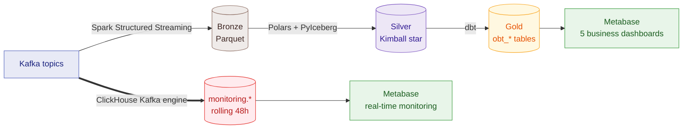

# Presentation layer — Metabase on ClickHouse

Phase 4 of the project: business dashboards over the gold OBT tables, plus the
bonus real-time pipeline monitoring read straight from Kafka.

Everything here is **provisioned from code**. The dashboards are not clicked
together in the UI and screenshotted — they are 24 SQL files plus a script, so
a review can read the business logic in git and a rebuild is one command.

```
metabase/
  questions/*.sql   one file per question; SQL + front matter
  provision.py      creates the ClickHouse connection, cards and dashboards
  README.md         this file
```

---

## 1. How the layer fits together



The thick arrow is the point of the bonus layer: monitoring **bypasses the
batch pipeline entirely**. If it went through bronze → silver → gold it would
report the health of the pipeline using the pipeline, which tells you nothing
at the moment the pipeline stops.

Both paths read the same Kafka cluster under **different consumer groups**
(`clickhouse_monitoring_*` vs the Spark jobs'), so monitoring never steals
messages from bronze ingestion.

---

## 2. Deploy

Three steps, in this order.

### 2.1 Build the monitoring tables in ClickHouse

Creates the Kafka-engine consumers, the MergeTree tables behind them and the
views Metabase charts.

```bash
# fresh volume: runs automatically via docker-entrypoint-initdb.d
docker compose up -d clickhouse

# already-provisioned server: run it by hand. Idempotent.
docker compose exec clickhouse bash \
  /docker-entrypoint-initdb.d/10-realtime-monitoring.sh
```

Verify it is consuming:

```bash
docker compose exec clickhouse clickhouse-client \
  --user "$CLICKHOUSE_USER" --password "$CLICKHOUSE_PASSWORD" \
  -q "SELECT * FROM monitoring.v_health_summary FORMAT Vertical"
```

`orders_last_5m` should be non-zero within a minute or two of the generator
running.

### 2.2 Confirm which database the gold tables landed in

dbt composes the schema name from `profiles.yml` (`schema: gold`) and
`dbt_project.yml` (`+schema: gold`). dbt's default `generate_schema_name`
concatenates the two, so on a stock setup the tables can land in **`gold_gold`**
rather than `gold`. Check once:

```bash
docker compose exec clickhouse clickhouse-client \
  --user "$CLICKHOUSE_USER" --password "$CLICKHOUSE_PASSWORD" -q 'SHOW DATABASES'
```

Set `GOLD_DB` in `.env` to whichever name is real. Everything downstream reads
it — the SQL files use a `{{GOLD_DB}}` placeholder that `provision.py`
substitutes.

### 2.3 Provision Metabase

```bash
# .env needs MB_ADMIN_EMAIL and MB_ADMIN_PASSWORD
docker compose --profile provision run --rm metabase-init
```

On a brand-new Metabase this completes the setup wizard and creates the first
admin. On an existing one it logs in. Either way it then creates or updates the
ClickHouse connection, all 24 cards and all 6 dashboards.

**It is idempotent** — objects are matched by name and updated, not
duplicated. Edit a `.sql` file and re-run to push the change.

To see what it would do without sending anything:

```bash
python3 metabase/provision.py --dry-run
```

---

## 3. The dashboards

| Dashboard | Cards | Answers |
|---|---|---|
| **Revenue & Discounts** | 5 | headline totals, gross vs net by month, discount rate, by category, by payment method |
| **Customer Journey** | 6 | funnel stages and drop-off, engagement by device, conversion by tier, wishlist → purchase |
| **Retention & Returns** | 6 | loyalty scorecard, revenue share, return rate by category and product, reasons, lag |
| **Real-Time Pipeline Monitoring** *(bonus)* | 7 | **NOT provisioned by default — see 4b.** freshness, order rate, funnel health, anomalies, status mix, dirty data, decode errors |

Dashboards are grouped by the **question a reader is asking**, not by source
table, and each reads as an inverted pyramid: headline totals, then the trend,
then the breakdown, then the detail table carrying the evidence. Filename order
is narrative order — the layout packer walks the files in order, and
`-- width:`/`-- height:` front matter controls the grid.

Two modelling rules are enforced across every query and are worth knowing before
reading any of them:

- **Money is measured at line grain from `obt_sales`.** `obt_orders` is a rollup
  of the same money — summing both double-counts. Order-grain questions
  (status, payment method, order counts) use `obt_orders`; value questions use
  `obt_sales`.
- **Facts of different grain are aggregated separately and then joined.**
  Joining sales to returns to events first and aggregating once multiplies every
  order by that user's event count. Every multi-fact query here uses subqueries
  joined on the shared key.

---

## 4. Known limitations — read before the demo

These are upstream data-generator defects, not gaps in this layer. Each is
quantified, and each query is written against the real column so it starts
working the day upstream is fixed, with no edit here.

| # | Limitation | Effect |
|---|---|---|
| 1 | `products.category` is NULL in **0 / 22,328** source messages | "Revenue by category" and "Return rate by category" each render a single `Unknown` bar. There is no join path from any fact to a category. Name-based inference was tested (47.2% coincidental matches over generated gibberish) and rejected as fabricated data. |
| 2 | `returns_refunds` has **no `return_quantity`** field | Return rate can only ever be `sum(refund_amount) / sum(net_sales_amount)`. A unit-based rate is not buildable from this source. |
| 3 | **1,595 / 2,908 returns (54.9%)** name an `order_item_id` never produced to `order_items` | Return-by-product is trustworthy for ~45% of returns. Unresolved ones carry the `-1` sentinel and are excluded from that chart rather than folded into a real product. The count is frozen while the table grows, so it is fixed history, not a live leak. |
| 4 | No `shipping_amount` anywhere in the source schemas | The revenue summary has five of the brief's six columns. Omitted rather than shown as a zero that would read as "we charge no shipping". |
| 5 | `orders.status` is **100% `created`** | The status-mix chart is a single flat series. Correct today; already watching for the day upstream emits shipped/cancelled/refunded. |
| 6 | ~96% of returns are **future-dated** by up to two weeks | Visible as a deliberate `future-dated (upstream bug)` bucket in the return-lag chart. Silver keeps these rows instead of clamping them, so the anomaly stays observable. |

One limitation that is **ours**, not upstream: the wishlist→purchase metric
matches on `(user, product)` pairs rather than enforcing that the purchase
happened after the wishlist add. `order_items` carries no timestamp of its own,
so a purchase can only be dated through its order — pair-level matching is the
honest version of this metric with this source.

---

## 4b. Status of the bonus monitoring layer — PARKED

The ClickHouse Kafka engine **cannot fetch from this project's broker**. Diagnosed
on the server, 2026-08-03:

- consumers connect and `num_messages_read` climbs (35,448) but **zero rows land**
- the error is per-message, `Local: Required feature not supported by broker`,
  and the messages are erased before decode
- **`kafka_format='RawBLOB'` returns nothing either**, so it is the fetch itself,
  not Avro
- librdkafka 2.15 from Python, in the `airflow-scheduler` container on the same
  host, consumes the same topic and partition without error
- `api_version_request=false` + `broker_version_fallback` did not change it

Two genuine bugs were found and fixed on the way, and both are worth keeping:
`kafka_max_block_size` defaults to ~1M rows, which blew ClickHouse's 3.6 GiB
internal ceiling on a 4 GB container (`MEMORY_LIMIT_EXCEEDED` x3183); and
`kafka_auto_offset_reset` is not a valid Kafka table setting in 24.8 — it is a
librdkafka option and belongs in `clickhouse/config.d/kafka.xml`.

The Kafka consumer tables and their materialized views have been **dropped on the
server** so nothing polls uselessly. The three MergeTree tables and all seven
views remain, so re-running `10-realtime-monitoring.sh` restores the layer intact
whenever the transport problem is solved.

Until then, provision without it:

```bash
python3 metabase/provision.py --exclude-dashboard "Real-Time Pipeline Monitoring"
```

Note also that the data generator was **stopped** at the time of writing (zero
new messages on `transactional.orders` and `behavioral.events` over a 20-second
watermark probe), so a live monitoring dashboard would have had nothing to show
regardless.

## 5. Verification status

The SQL, the provisioning script and the compose wiring are complete and
statically checked:

- `docker compose config` renders all 17 services including `metabase-init`
- `provision.py --dry-run` parses all 24 questions into 6 dashboards
- `bash -n` and `py_compile` pass

They have **not** been executed against the live stack in this session — GitLab
was down and there was no SSH credential for the deploy host. Run section 2 on
the server and check `monitoring.v_health_summary` returns rows before
presenting.

The Metabase REST API is not a stable public contract and does shift between
releases; this targets the v0.62 shape. If a call starts failing after an
upgrade, `--dry-run` shows exactly what it would send, and every dashboard can
be rebuilt by hand from the same `.sql` files.

---

## 6. Adding a question

Drop a file in `questions/`. The front matter is the only contract:

```sql
-- name: Refunds by return reason
-- dashboard: Returns & Refunds
-- display: row
-- description: Which reasons cost the most money.
-- viz: {"pie.dimension": "return_reason", "pie.metric": "refunds"}
SELECT ...
FROM {{GOLD_DB}}.obt_returns
```

- `dashboard` must be one of the six names in `DASHBOARDS` in `provision.py`
- `display` is any Metabase display: `table`, `bar`, `line`, `row`, `pie`,
  `scalar`, `funnel`, `area`
- `viz` is optional raw JSON, needed for `funnel` and `pie` which require an
  explicit dimension and metric
- `{{GOLD_DB}}` is substituted; `monitoring.*` is referenced directly

Then re-run the provision command. Layout is automatic: `table` cards take the
full 24-column width, everything else takes half.
