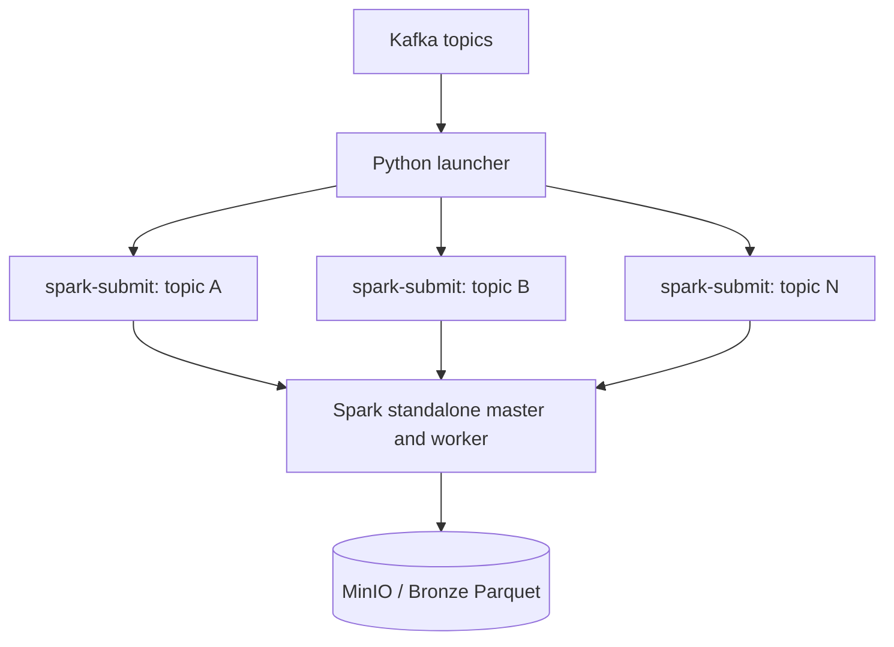

# Spark configuration and Bronze execution

This directory contains the custom Spark image and the shared S3A configuration
for the local Spark standalone cluster. The same image is used by `spark-master`,
`spark-worker`, and `bronze-ingestion`, with different container commands.

## How it works

The cluster uses **Spark standalone**, not YARN or Kubernetes. `spark-master`
coordinates applications; `spark-worker` supplies executor resources. The
`bronze-ingestion` container runs a **Python launcher** that submits **one
independent Spark application per Kafka topic** to
`spark://spark-master:7077`.

The final entry point is `jobs/run_bronze_ingestion.py`:

- Without `--topic`, it imports `bronze_ingestion.launcher.submit_all()` under
  plain Python, without importing PySpark.
- For each configured Kafka topic, `launcher.py` starts a separate
  `spark-submit ... --topic <topic>` child process.
- With `--topic`, the entry point imports `bronze_ingestion.main.run(topic)`;
  that application owns one long-running Structured Streaming query.
- The launcher monitors each child and restarts failed applications
  independently with exponential backoff (up to five minutes). The Docker
  restart policy is a fallback for failure of the launcher itself.

This replaces an earlier, superseded design in which all topics shared one
Spark application and FAIR-scheduler pools. **The final implementation does
not rely on per-topic FAIR-scheduler pools.**



The diagram shows an illustrative number of topics; the actual list comes
from `KAFKA_TOPICS`.

## Resource allocation and failure handling

`launcher.py` divides the configured worker cores and memory across the topic
count and passes `--total-executor-cores` and `--executor-memory` to each
submission. Each application uses `--driver-memory 512m` and runs in Spark
client mode, so the `bronze-ingestion` container must have enough memory for
all of its driver JVMs.

If the topic count exceeds the available worker cores, the minimum allocation
of one core per application can exceed capacity; **concurrent execution is not
guaranteed**. The launcher staggers initial submissions and applies increasing
backoff to repeatedly failing applications, allowing healthy topics to
continue independently.

Each topic has its own Structured Streaming checkpoint under MinIO. Checkpoints
allow a restarted topic application to resume its stream. See
[`jobs/bronze_ingestion/README.md`](../jobs/bronze_ingestion/README.md) for
Avro decoding, dead-letter routing, and the at-least-once write semantics.

## Files

- `Dockerfile` — builds the custom Spark image with Kafka, Avro and S3A JARs,
  plus Bronze Python dependencies. Build context is the repository root so
  the image can copy `jobs/`.
- `conf/spark-defaults.conf` — bind-mounted shared Spark/Hadoop configuration.

## S3A configuration

The configuration points Hadoop's S3A connector at MinIO rather than AWS S3:

```properties
spark.hadoop.fs.s3a.endpoint                  http://minio:9000
spark.hadoop.fs.s3a.path.style.access         true
spark.hadoop.fs.s3a.impl                      org.apache.hadoop.fs.s3a.S3AFileSystem
spark.hadoop.fs.s3a.connection.ssl.enabled    false
spark.hadoop.fs.s3a.aws.credentials.provider  com.amazonaws.auth.EnvironmentVariableCredentialsProvider
```

- Port `9000` is MinIO's S3 API, not its web console (`9001`).
- Path-style bucket addressing avoids virtual-host-style bucket names.
- TLS is not terminated in front of MinIO in this local deployment.
- `AWS_ACCESS_KEY_ID` and `AWS_SECRET_ACCESS_KEY` are supplied through the
  container environment from `.env`, not committed to this configuration file.

Additional connection settings used by this stack:

```properties
spark.hadoop.fs.s3a.connection.timeout           5000
spark.hadoop.fs.s3a.connection.establish.timeout 5000
spark.hadoop.fs.s3a.attempts.maximum             3
spark.hadoop.fs.s3a.retry.limit                  3
spark.hadoop.fs.s3a.change.detection.mode        none
```

These limit retries and disable object-version-based change detection in the
local MinIO setup. Confirm the exact settings in `conf/spark-defaults.conf`
before deploying a changed version of the stack.

## JAR dependencies

The image bundles dependencies required for Spark 3.5.3, including:

- `hadoop-aws-3.3.4.jar` and `aws-java-sdk-bundle-1.12.262.jar` for S3A.
- `spark-sql-kafka-0-10_2.12-3.5.3.jar`,
  `spark-token-provider-kafka-0-10_2.12-3.5.3.jar`,
  `kafka-clients-3.4.1.jar`, and `commons-pool2-2.11.1.jar` for Kafka.
- `spark-avro_2.12-3.5.3.jar` and `xz-1.9.jar` for Avro.

These are baked into `/opt/spark/jars/` at image-build time. Jobs do not need
`--packages` or access to Maven Central at runtime. Keep connector versions
aligned with the Spark/Hadoop versions in the base image when upgrading.

## Python dependencies

The custom image installs Bronze dependencies, including
`pydantic-settings==2.8.1`, pinned for compatibility with the Python version
in the Spark base image.

## Updating and rebuilding

Changes to `spark-defaults.conf` take effect after restarting the Spark
services, since the file is bind-mounted:

```bash
docker compose restart spark-master spark-worker bronze-ingestion
```

Changes to the Dockerfile, dependency versions, JARs or files copied into the
image require a rebuild:

```bash
docker compose build spark-master spark-worker bronze-ingestion
docker compose up -d spark-master spark-worker bronze-ingestion
```

For single-topic execution and troubleshooting, see the Bronze README.
